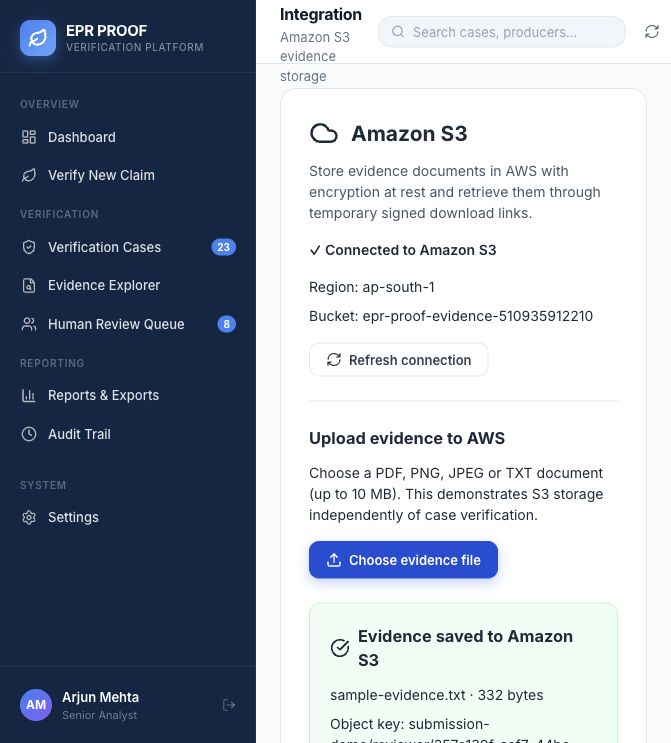
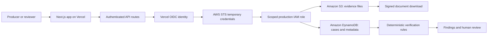
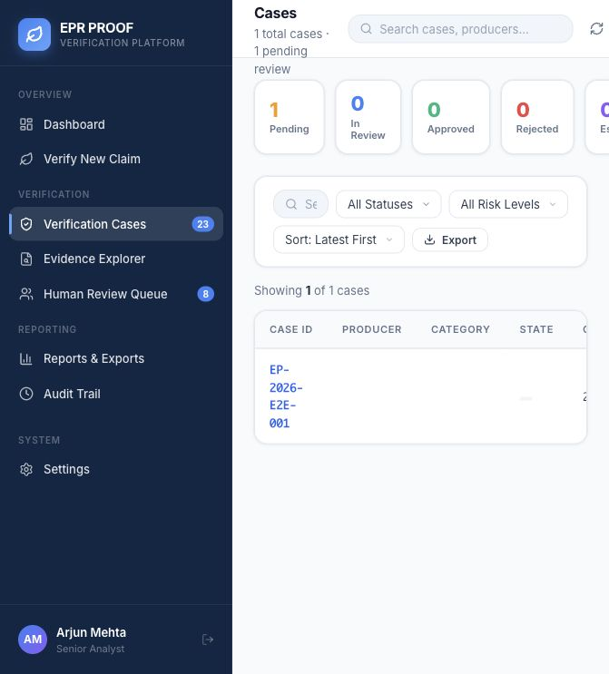

# EPR Proof

### AWS-backed evidence verification for recycling claims

EPR Proof helps reviewers compare EPR/e-waste recycling claims with supporting documents, find contradictions, and calculate a deterministic risk score for human review.

> “EPR Proof doesn't decide whether a recycler is fraudulent. It shows exactly where the evidence stops agreeing.”

**[Live application](https://erp-proof.vercel.app/) · [AWS demo](https://erp-proof.vercel.app/settings) · [Submission guide](SUBMISSION.md) · [Verified AWS test receipt](submission/aws-validation.json)**

## Live AWS showcase

The deployed application uses **Amazon S3** for evidence files and **Amazon DynamoDB** for case records. **AWS IAM + Vercel OIDC** provides scoped, temporary credentials to the production backend.



*Captured from the production application on 11 October 2026. The screen shows a real S3 connection, the uploaded file, its object key, and a temporary download action. The sample document is synthetic.*

| AWS service | How EPR Proof uses it | Verified status |
| --- | --- | --- |
| **Amazon S3** | Stores evidence documents, encrypts demo uploads with AES-256, and provides time-limited signed download links. | Production connection, upload, and byte-for-byte download passed. |
| **Amazon DynamoDB** | Persists case metadata, evidence metadata, verification findings, and audit entries using a single-table design. | Existing table is ACTIVE; authenticated production cases API returned HTTP 200 with a persisted case. |
| **AWS IAM / STS** | Lets the specific Vercel production project assume a role through OIDC and obtain temporary AWS credentials. | Production S3 and DynamoDB requests succeeded through the configured role. |
| **Amazon Bedrock** | Implements structured document extraction, preprocessing, confidence fields, and Zod validation. | Integration is implemented; live extraction is not verified. The production role does not grant Bedrock invocation permissions. |

## How the AWS workflow works



### 1. Amazon S3 — evidence storage and retrieval

The **Settings → AWS Integration** screen demonstrates the complete storage flow independently of case verification:

1. The authenticated backend checks the configured bucket with `HeadBucket`.
2. A reviewer selects a PDF, JPEG, PNG, or TXT file, up to **10 MB**.
3. `/api/aws/s3` uploads the file with `PutObject` and **AES-256 server-side encryption**.
4. The object receives a unique key under `submission-demo/<owner>/<uuid>-<filename>`.
5. The application returns an upload receipt and a **signed download URL valid for one hour**.
6. The validation script downloads the stored document and checks that its bytes match the uploaded file exactly.

The case evidence workflow also supports direct uploads using **15-minute presigned URLs**. Evidence confirmation reads the S3 object, calculates its **SHA-256 hash**, and stores that hash in the evidence metadata.

**Implementation:** [S3 demo API](src/app/api/aws/s3/route.ts), [storage helpers](src/lib/aws/s3/storage.ts), [evidence confirmation](src/app/api/cases/%5Bid%5D/evidence/%5BevidenceId%5D/confirm/route.ts).

### 2. Amazon DynamoDB — persistent cases and review evidence

The `EPRProof` table in **ap-south-1 (Mumbai)** stores related records under a shared case partition key:

| Record | Partition key (`PK`) | Sort key (`SK`) |
| --- | --- | --- |
| Case metadata | `CASE#<caseId>` | `CASE#<caseId>` |
| Evidence metadata | `CASE#<caseId>` | `EVIDENCE#<evidenceId>` |
| Verification finding | `CASE#<caseId>` | `FINDING#<findingId>` |
| Audit entry | `CASE#<caseId>` | `AUDIT#<entryId>` |

A query on the case partition retrieves the case and its associated records. The current case listing uses a scan with optional producer filtering. Verification results and review updates are written back through the repository.

**Implementation:** [DynamoDB repository](src/lib/aws/dynamodb/repository.ts), [key schema](src/lib/aws/dynamodb/schema.ts), [cases API](src/app/api/cases/route.ts).



*The registry is populated through the authenticated `/api/cases` endpoint. Case content is synthetic demo data.*

### 3. AWS IAM + Vercel OIDC — production authentication

The production backend uses `EPRProofVercelProduction` through the official Vercel AWS OIDC credentials provider. The role trusts only:

- Vercel team: `nitishkumar11930-7654s-projects`
- Project: `erp-proof`
- Environment: `production`

Its policy permits bucket checks, evidence object reads/writes/deletes under the configured `cases/*` and `submission-demo/*` prefixes, and the required read/write operations on the single `EPRProof` DynamoDB table. It grants no IAM administration or Bedrock model invocation permissions.

AWS access keys are not stored in GitHub or Vercel. Local development uses the AWS SDK's normal credential chain; production uses temporary federation credentials. The cookie signing secret is stored separately in Vercel environment variables.

**Configuration:** [credential provider](src/lib/aws/credentials.ts), [role trust policy](infra/vercel-trust.json), [resource permissions](infra/vercel-permissions.json).

### 4. Amazon Bedrock — implemented extraction pipeline

The extraction provider reads evidence from S3, preprocesses documents, invokes the configured Bedrock model, and validates the returned structure with Zod. Extracted facts feed the deterministic verification engine.

Bedrock model access and invocation permissions must be configured before demonstrating this feature live. Failed extraction is returned with `extractionStatus: FAILED` and warnings. **The verified S3 storage demo works independently of Bedrock.**

**Implementation:** [Bedrock provider](src/lib/ai/providers/bedrock.ts), [document preprocessing](src/lib/ai/preprocessing/documentPreprocessor.ts).

## Verified production evidence

Validation ran against **https://erp-proof.vercel.app** on **11 October 2026**:

| Check | Result |
| --- | --- |
| Demo authentication | HTTP 200 |
| Amazon S3 bucket connection | PASS |
| Real evidence upload | PASS |
| Signed download and exact byte comparison | PASS |
| Authenticated DynamoDB cases API | HTTP 200; one persisted case returned |
| Unit tests | 21 passed across 5 suites |
| Production build | PASS |

The machine-readable [S3 validation receipt](submission/aws-validation.json) records the object key and SHA-256 checksum without including credentials or signed URLs.

```text
SHA-256: bf69e5a5e9136c0b514486c31a78f00783ef73edcd69167996d6f65b538fca03
```

## Two-minute demo for judges

1. Open [the live application](https://erp-proof.vercel.app/).
2. Sign in as the demo reviewer:
   - **Email:** `demo@eprproof.ai`
   - **Password:** `EPRProof@2026`
3. Open **Settings** and show **Connected to Amazon S3**.
4. Upload [the synthetic sample evidence](submission/sample-evidence.txt).
5. Show the upload receipt and click **Open stored document** to retrieve it from S3.
6. Open **Verification Cases** to show the persisted DynamoDB case.
7. Explain how verification findings support a human review decision.

Demo authentication and case data are synthetic. This is a hackathon demonstration; live Bedrock extraction is not part of the verified demo.

## Local development

```bash
npm ci
aws login --region ap-south-1
npm run dev
```

Create `.env.local` with your own resource names and a securely generated signing secret:

```dotenv
AWS_REGION=ap-south-1
AWS_S3_BUCKET=your-evidence-bucket
AWS_DYNAMODB_TABLE=EPRProof
API_SECRET=replace-with-a-random-secret
# Optional, after Bedrock model access is configured:
AWS_BEDROCK_MODEL_ID=anthropic.claude-3-haiku-20240307-v1:0
```

Do not set `AWS_ROLE_ARN` for ordinary local development: the committed trust policy permits production only. On Vercel, set `AWS_ROLE_ARN` to the configured production role ARN alongside the resource names and `API_SECRET`.

## Validation commands

```bash
npm test
npm run build
# With a running local app and active AWS session:
node scripts/test-s3-demo.mjs
# Verify the deployed app:
DEMO_BASE_URL=https://erp-proof.vercel.app node scripts/test-s3-demo.mjs
```

The S3 script uploads a synthetic object and saves its result to `submission/aws-validation.json`. It returns a failure when connection, upload, or retrieval fails.

## Technology

**Next.js App Router · React · TypeScript · AWS SDK v3 · Amazon S3 · Amazon DynamoDB · AWS IAM/STS · Vercel OIDC · Zod · Vitest · Vanilla CSS**

The verification engine checks quantities, missing evidence, dates, entities, batch references, and duplicate evidence. Risk scores are deterministic; reviewers retain the final decision.
